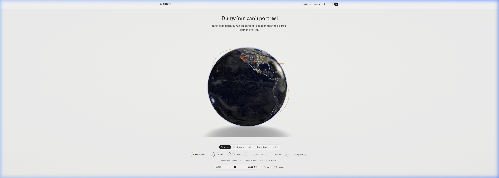
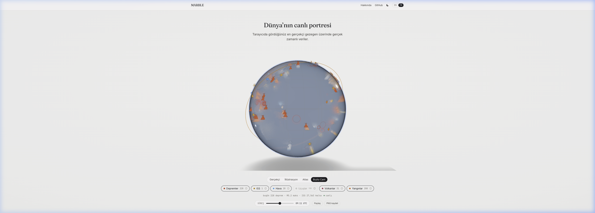
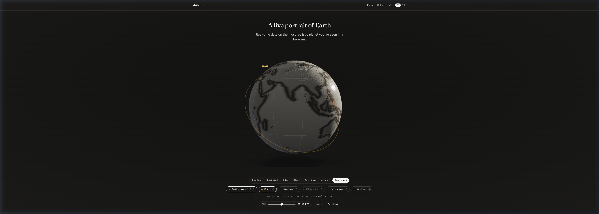
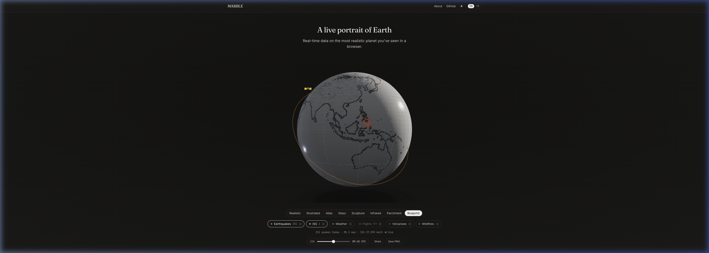
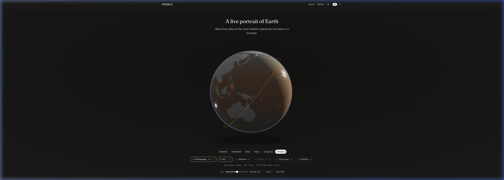
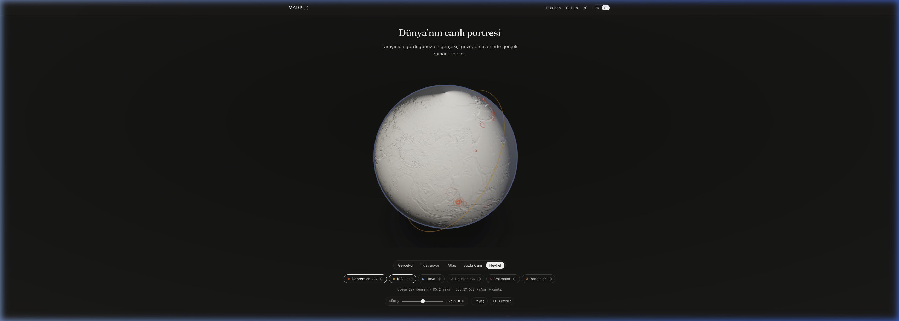
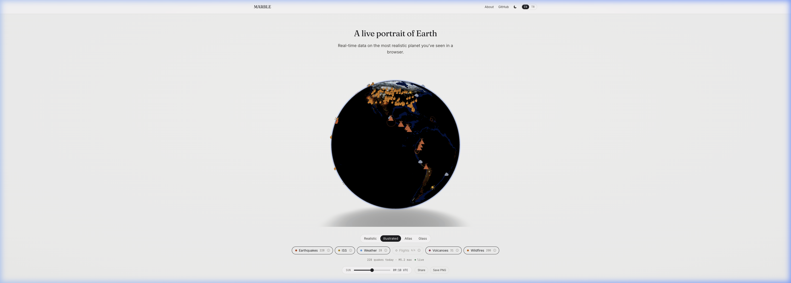

<div align="center">



<p>
  <a href="https://marble-drab-delta.vercel.app"></a>
  
  
  
</p>

<p><em>A hyper-realistic, slowly rotating Earth on a clean editorial page: the planet as a museum piece, not a sci-fi dashboard.<br>
On its surface, the world as it happens: earthquakes, the ISS, weather, volcanoes, wildfires and flights.</em></p>

<a href="https://marble-drab-delta.vercel.app"></a>

</div>


## Eight ways to see one planet

<table>
  <tr>
    <td width="33%"></td>
    <td width="33%"></td>
    <td width="33%"></td>
  </tr>
  <tr>
    <td align="center"><code>glass</code></td>
    <td align="center"><code>parchment</code> · 17th-century cartography</td>
    <td align="center"><code>blueprint</code></td>
  </tr>
  <tr>
    <td width="33%"></td>
    <td width="33%"></td>
    <td width="33%"></td>
  </tr>
  <tr>
    <td align="center"><code>infrared</code></td>
    <td align="center"><code>sculpture</code></td>
    <td align="center"><code>illustrated</code></td>
  </tr>
</table>

Realistic, Illustrated, Atlas, Glass, Sculpture, Infrared, Parchment and Blueprint all switch instantly, on the same planet with the same live layers.


## Features

| | |
|---|---|
| **Hyper-realistic Earth** | NASA Blue Marble albedo, relief and roughness maps, Black Marble city lights, animated clouds and atmosphere under studio lighting. |
| **Real-time terminator** | The day–night line from the actual date and time, with a draggable sun scrubber. |
| **Living data layers** | Earthquakes, ISS, weather, volcanoes, wildfires and flights, each with its own visual language instead of dots. |
| **ISS tracking** | A spacecraft sprite, an always-visible orbit tube and a live trail. |
| **Seismic wavefronts** | Quakes render as expanding waves scaled by magnitude, so M2 and M8 never look alike. |
| **Museum panels** | Click anything for enriched stats, Wikipedia imagery, ISS crew, nearest city and source attribution. |
| **Light and dark · TR / EN** | Editorial light and dark themes and full Turkish / English localisation. |
| **Share and export** | View URLs that keep style, layers and sun position, and one-click PNG capture. |

| Layer | Source |
|---|---|
| Earthquakes | USGS Earthquake Hazards Program |
| ISS position and crew | wheretheiss.at · Open-Notify |
| City weather | Open-Meteo |
| Volcanoes · wildfires | NASA EONET |
| Flights | OpenSky Network (optional OAuth2) |
| Place imagery | Wikipedia REST |


## Türkçe özet

**MARBLE**, temiz ve editoryal bir sayfada yavaşça dönen hiper-gerçekçi bir Dünya. NASA görüntüleri, özel PBR gölgeleme, gerçek zamanlı gece-gündüz çizgisi ve ayrı bir bulut katmanı sayesinde render mı fotoğraf mı ayırt etmek zor. Üzerinde depremler, ISS, hava durumu, volkanlar, yangınlar ve uçuşlar canlı olarak, her biri kendi görsel diliyle çiziliyor. Sekiz farklı küre stili, açık/koyu tema ve Türkçe/İngilizce arayüzü var.


## Development

```sh
pnpm install
pnpm textures          # fetch the NASA texture set
cp .env.local.example .env.local   # optional OpenSky credentials
pnpm dev               # http://localhost:3000
pnpm test              # vitest
pnpm build
```

```
components/earth/     globe, shaders, clouds, atmosphere, styles
components/layers/    quakes, ISS, weather, volcanoes, fires, flights
components/landing/   editorial page sections
lib/                  data clients, geo maths, panel enrichment, i18n
store/                zustand stores for globe, layers, time, theme, language
```

<div align="center">
<br>
<a href="https://github.com/kutluhangil"></a>
<sub>Imagery from NASA Blue Marble and Black Marble · data from USGS, NASA EONET, Open-Meteo and OpenSky.</sub>
</div>
